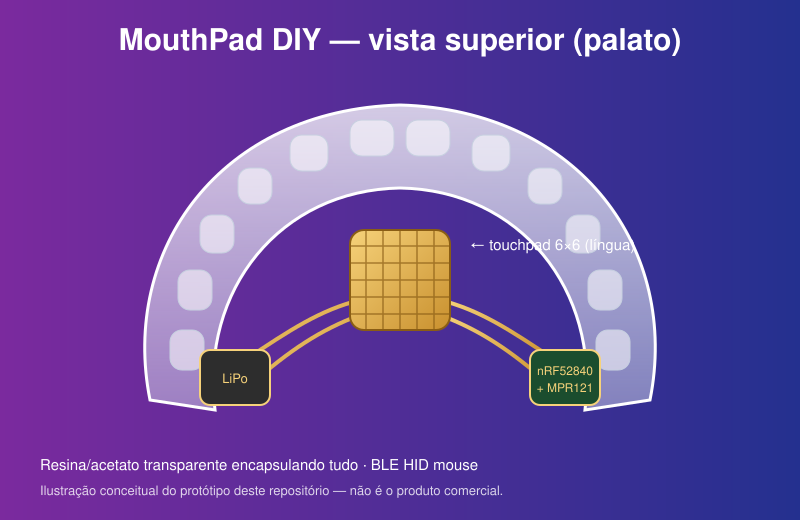
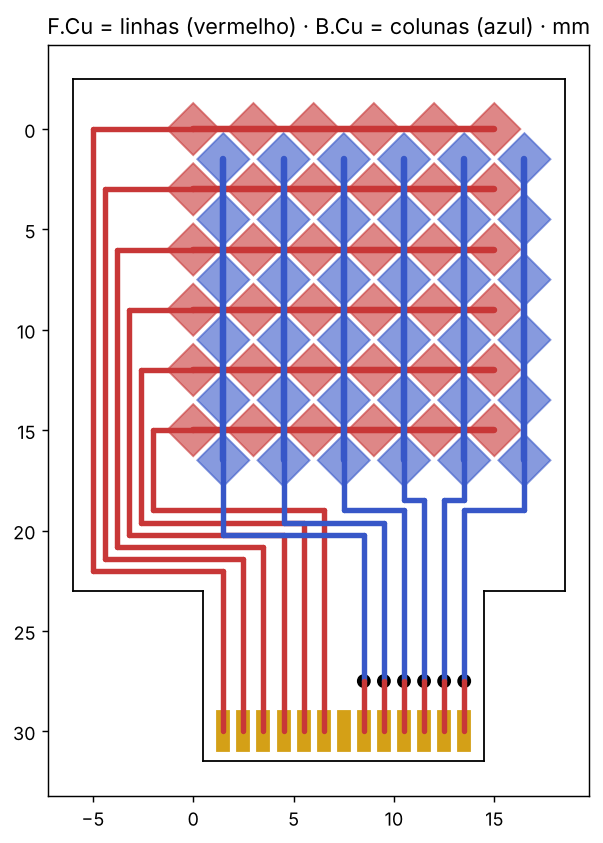

# MouthPad DIY 👅🖱️

Um **touchpad intraoral controlado pela língua**, de código aberto, inspirado no
[MouthPad^](https://www.augmental.tech/) (Augmental / MIT Media Lab, US$ 1.399).
Ele é uma placa transparente, parecida com uma contenção ortodôntica, encaixada no céu da boca. No centro fica um
sensor capacitivo: a língua desliza para mover o cursor e toca para clicar.
O dispositivo se conecta como **mouse Bluetooth (BLE HID)** a PC, Android, iOS e tablets, sem driver.



> ⚠️ **Aviso de segurança.** Este é um projeto experimental, **não é um dispositivo médico**.
> Baterias de lítio e eletrônica dentro da boca oferecem risco de vazamento, aquecimento,
> engasgo e choque químico. Siga as fases abaixo, **só leve à boca uma montagem 100% selada**
> com materiais biocompatíveis e, de preferência, com acompanhamento de um dentista ou protético.

---

## 1. Como funciona

| Função | Gesto da língua |
|---|---|
| Mover cursor | deslizar sobre o pad |
| Clique esquerdo | toque curto (< 0,25 s) |
| Clique direito | encostar e segurar parado (> 0,8 s) |

O sensor é uma **grade 6 × 6 de eletrodos** (6 linhas + 6 colunas) lida por um
**MPR121**. O firmware calcula o centroide da capacitância em cada eixo, o que dá uma
posição X/Y contínua com resolução bem maior que 6 × 6. Depois converte o movimento em
deslocamento relativo do mouse, enviado via BLE pelo **nRF52840**.

## 2. Fases do projeto

1. **Bancada:** tudo em protoboard, com o sensor tocado pelo dedo, para validar firmware e BLE.
2. **Haste externa:** o sensor fica numa haste junto aos lábios e a eletrônica fora da boca, para testar a ergonomia com a língua.
3. **Intraoral:** flex-PCB fina, eletrônica encapsulada em resina biocompatível e placa moldada na arcada do usuário.

## 3. Lista de materiais

| # | Item | Qtde | Observação | Preço aprox. |
|---|---|---|---|---|
| 1 | Seeed Studio **XIAO nRF52840** | 1 | BLE 5, 21 × 17,5 mm, carregador LiPo embutido | R$ 90 |
| 2 | **MPR121** (breakout ou CI QFN-20) | 1 | sensor capacitivo de 12 canais, I²C 0x5A | R$ 25 |
| 3 | Bateria **LiPo 3,7 V 40–80 mAh** (ex.: 401012 / 501015) | 1 | com proteção (PCM) | R$ 30 |
| 4 | Eletrodos: PCB flexível (poliimida) **ou** fita de cobre 0,05 mm + filme Kapton | 1 | grade 6 × 6, pad de ~18 × 18 mm, banhado a ouro (ENIG) na versão final | R$ 40–150 |
| 5 | Fio esmaltado AWG 36–40 | 1 m | ligações | R$ 10 |
| 6 | Chave reed ou micro-chave liga/desliga | 1 | a reed permite ligar com ímã sem furar o encapsulamento | R$ 5 |
| 7 | Placa de **acetato/PETG 1 mm** para termoformagem (vacuum-former odontológico) | 1 | corpo da placa | R$ 15 |
| 8 | Modelo de gesso da arcada superior | 1 | moldagem com alginato ou feita pelo dentista | R$ 0–80 |
| 9 | **Resina biocompatível** (classe IIa, ex.: resina para placas de bruxismo) ou silicone grau médico | — | encapsulamento | R$ 100+ |
| 10 | Bobina Qi miniatura (opcional) | 1 | carga sem contatos expostos | R$ 25 |

Custo total do protótipo: **≈ R$ 300 a R$ 550**.

## 4. Esquema elétrico

```
                 ┌──────────────────────────┐
  LiPo 3,7V (+)──┤BAT+     XIAO nRF52840    │
  LiPo      (-)──┤BAT-                      │
                 │                    3V3 ──┼──────────┬──────────► VCC MPR121
                 │                    GND ──┼────────┬─┼──────────► GND MPR121
                 │              D4 / SDA ───┼────────┼─┼──────────► SDA (pull-up 4,7k*)
                 │              D5 / SCL ───┼────────┼─┼──────────► SCL (pull-up 4,7k*)
                 │                    D3 ◄──┼────────┼─┼─────────── IRQ (opcional)
                 └──────────────────────────┘        │ │
                 * breakouts Adafruit/Sparkfun já trazem os pull-ups;  ADDR → GND (0x5A)

     MPR121                         Grade de eletrodos (vista do palato)
  ┌───────────┐                      C0  C1  C2  C3  C4  C5
  │ E0..E5  ──┼── linhas L0..L5      │   │   │   │   │   │
  │ E6..E11 ──┼── colunas C0..C5  L0─◆───◆───◆───◆───◆───◆─
  └───────────┘                   L1─◆───◆───◆───◆───◆───◆─
                                  L2─◆───◆───◆───◆───◆───◆─    ◆ = losangos de cobre
                                  L3─◆───◆───◆───◆───◆───◆─    linhas na camada de cima,
                                  L4─◆───◆───◆───◆───◆───◆─    colunas na de baixo
                                  L5─◆───◆───◆───◆───◆───◆─    (padrão "diamond")
```

**Dicas de layout**
- Use pitch de ~3 mm entre eletrodos e cubra a grade com 0,3–0,5 mm de resina. A língua atua através dela.
- Coloque um plano de GND hachurado **atrás** da grade (lado oposto à língua) para reduzir ruído.
- Mantenha a antena do nRF52840 longe do GND e da bateria. A saliva atenua o sinal, por isso a antena deve ficar no lado voltado para os dentes.

## 4.1 Layout KiCad da grade flexível

Arquivos em [`hardware/kicad/`](hardware/kicad/), abertos no KiCad 8:
- `mouthpad_grid.kicad_pcb`: placa pronta, gerada pelo script
- `gen_grid.py`: gerador paramétrico. Altere `P` (pitch), `H` (tamanho do losango) ou `N` (tamanho da grade) e rode `python3 gen_grid.py`



| Parâmetro | Valor |
|---|---|
| Substrato | flex de poliimida de 2 camadas, 25 µm, cobre de 18 µm, acabamento ENIG |
| Área sensível | ~18,5 × 19 mm, losangos com pitch de 3 mm e gap de ~0,28 mm |
| Linhas R0–R5 | camada F.Cu (lado da língua) |
| Colunas C0–C5 | camada B.Cu |
| Cauda | 13 pads com pitch de 1,0 mm (R0–R5, GND, C0–C5), para conector FPC ZIF de 13 vias ou solda direta |
| Ligação ao MPR121 | R0–R5 → E0–E5 e C0–C5 → E6–E11 |

**Antes de fabricar:**
- Rode *Fill All Zones* (atalho B) e o DRC no KiCad.
- Se possível, encomende com reforço (stiffener) de PI de 0,2 mm sob a cauda e coverlay sobre a grade.
- Fabricantes como JLCPCB e PCBWay fazem flex de 2 camadas por ~US$ 20–40 o lote.

## 5. Software

Firmware em **CircuitPython**: [`firmware/code.py`](firmware/code.py)

### Instalação
1. Instale o [CircuitPython 9.x para XIAO nRF52840](https://circuitpython.org/board/Seeed_XIAO_nRF52840_Sense/) (dois toques rápidos no RESET abrem o drive UF2).
2. Instale as bibliotecas:
   ```bash
   pip install circup
   circup install adafruit_ble adafruit_hid adafruit_mpr121
   ```
3. Copie `firmware/code.py` para o drive `CIRCUITPY`.
4. No computador ou celular, procure o dispositivo Bluetooth **"MouthPad DIY"** e pareie.

### Parâmetros ajustáveis (topo do `code.py`)
| Constante | Função |
|---|---|
| `SENSIBILIDADE` | velocidade do cursor |
| `LIMIAR` | quanto de variação capacitiva conta como toque (aumente se a saliva gerar toques falsos) |
| `TAP_MAX` / `HOLD_MIN` | tempos de clique esquerdo e direito |
| `SUAVIZACAO` | filtro contra tremores (0 a 0,9) |

### Fluxo do firmware
```
anuncia BLE ──► conectado? ──► lê 12 canais MPR121 ──► delta = baseline − filtrado
                                     ▲                        │
                                     │          centroide X (colunas) / Y (linhas)
                                     │                        │
                                     └── 10 ms ◄── mouse.move / click ◄── gestos
```

## 6. Arte e construção física

A arte conceitual está em [`docs/mouthpad-diy.svg`](docs/mouthpad-diy.svg) e reproduz o visual do original: resina
transparente, trilhas e pad dourados ao centro, bateria e microcontrolador nas laterais (região dos molares).

**Montagem da versão intraoral (fase 3):**
1. Faça um modelo de gesso da arcada superior.
2. Termoforme uma placa base de acetato/PETG de 1 mm.
3. Cole a flex-PCB da grade no centro do palato, com os eletrodos voltados para a língua.
4. Posicione a LiPo de um lado e o XIAO e o MPR121 do outro. Use a versão em CI/flex do MPR121 para reduzir altura.
5. Encapsule tudo com resina biocompatível em camadas finas e cure conforme o fabricante. Faça o acabamento liso, sem bordas.
6. Teste a vedação submergindo a peça em soro fisiológico por 24 h antes de qualquer uso.
7. Carregue por bobina Qi ou por pads magnéticos selados.

## 7. Diferenças em relação ao produto comercial

| | MouthPad^ | MouthPad DIY |
|---|---|---|
| Sensor | trackpad de alta resolução + IMU | grade 6 × 6 interpolada |
| Espessura | ~0,7 mm, customizada | 2–4 mm (protótipo) |
| Certificação | material de grau odontológico | por conta do construtor |
| Bateria | ~5 h | ~6–10 h com 60 mAh (estimativa) |
| Custo | US$ 1.399 | ≈ R$ 400 |

## 8. Próximos passos
- [ ] IMU (ex.: LSM6DS3, já presente no XIAO Sense) para gestos de cabeça
- [ ] Rolagem com dois toques e arraste
- [ ] App de calibração
- [x] Layout KiCad da flex-PCB
- [ ] Plano de GND hachurado (exige flex de 3 camadas)

## Licença
MIT. Projeto educacional sem afiliação com a Augmental.
